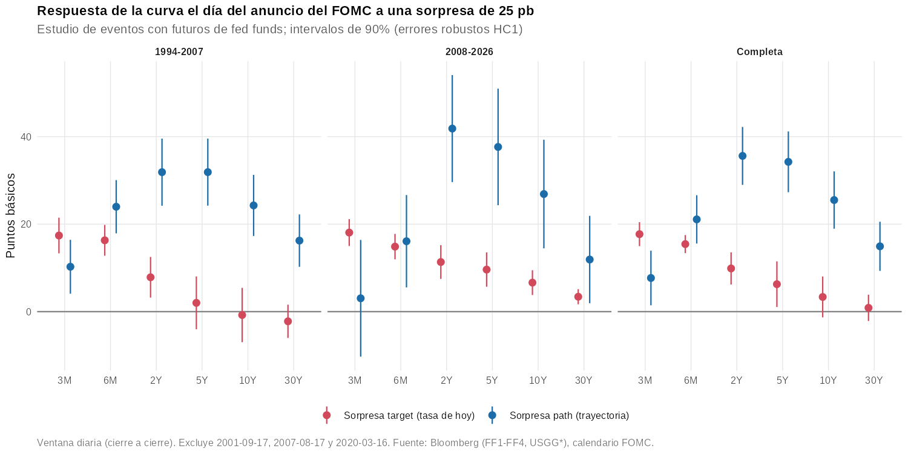

# VAR de tasas: choques de la Fed y la curva del Tesoro de EE.UU.

**Pregunta.** ¿Cómo responden las tasas y los precios de los bonos del Tesoro (corto, mediano y largo plazo) ante un alza o un recorte de la tasa de la Fed?

**Datos.** Bloomberg vía R (`Rblpapi`), 1988-01 a 2026-10, mensual. Fed funds efectiva (`FEDL01`), rendimientos genéricos del Tesoro a 3M, 2Y, 5Y, 10Y y 30Y (`USGG*`), producción industrial (`IP`), IPC (`CPI INDX`), commodities (`BCOM`) e índices total return del Tesoro por tramo (`LT01`–`LT11TRUU`).

**Método.** VAR en niveles con identificación recursiva (Cholesky): la macro no reacciona dentro del mes al choque de política; las tasas de mercado sí. Bandas bootstrap de 68% y 90%. Asimetría alza/recorte con proyecciones locales (Jordà 2005). Robustez con BVAR Minnesota (Banbura, Giannone y Reichlin 2010), rezagos, ordenamiento y muestra.

## Resultados clave


1. **La transmisión de la fed funds cae con el plazo.** Un alza de 25 pb (1988-2007) sube el 3M en 17 pb, el 2Y en 14, el 5Y en 9.5, el 10Y en 6 y el 30Y en 3 al impacto. **La curva se aplana:** 10Y−3M cae 11 pb.
2. **En precios el efecto crece con el plazo:** −0.27% en el bono a 2 años, −0.46% en el de 10 y −0.48% en el de 30, porque la duración compensa el menor movimiento del rendimiento.
3. **Lo que mueve los bonos largos es la trayectoria esperada, no la tasa de hoy.** Un choque de 25 pb al 2Y (muestra completa) sube el 10Y en 19.5 pb y el 30Y en 14 pb, con caídas de precio de 1.6% y 2.1%. Es entre 3 y 4.5 veces la transmisión de un choque a la fed funds.
4. **Las sorpresas de la fed funds explican poco de la curva:** 3-16% de la varianza de las tasas a 12 meses.
5. **Simetría:** en los primeros ~20 meses alza y recorte son espejo. Antes de 2008 no hay evidencia de asimetría. En la muestra completa los recortes tienden a revertirse después de 2 años. Eso parece reflejar el ciclo (recesión y luego recuperación) más que una transmisión asimétrica.
6. **Robusto:** los efectos al impacto. **No robusto:** la dinámica de mediano plazo (una oscilación del tramo largo entre los meses 5 y 15 desaparece en el BVAR y con 3 rezagos).
7. **Validación de precios:** los índices total return de Bloomberg dan caídas de −1.40% (7-10 años) y −2.24% (20+ años), en línea con el cálculo por duración (−1.55% y −2.13%).

Detalle de decisiones, tests fallidos y lectura económica: **[docs/hallazgos.md](docs/hallazgos.md)**.

## Ejercicio con la EFFR y sorpresas de mercado



Con los futuros de fed funds (FF1-FF4) se mide la parte **inesperada** de cada una de las 269 decisiones del FOMC entre 1994 y 2026. Esa sorpresa se usa como instrumento para un VAR con la **EFFR** como tasa de política.

1. **Lo esperado ya está en precios.** Solo la parte inesperada de un cambio de meta mueve la curva (Kuttner): 25 pb inesperados suben el 3M 17 pb y el 2Y 10 pb.
2. **La tasa de hoy mueve el tramo corto; la trayectoria mueve el largo.** Una sorpresa sobre la tasa actual no mueve el 10Y ni el 30Y. Una sorpresa sobre la trayectoria (FF4) de 25 pb sube el 2Y 32-42 pb y el 10Y 24-27 pb.
3. **VAR con EFFR y toda la muestra (1988-2026):** el instrumento es fuerte (F = 16). Un alza de 25 pb sube el 3M 22 pb y el 2Y 15 pb, deja el 10Y sin cambio y baja el 30Y 2 pb: aplanamiento fuerte. Cholesky sobreestimaba la transmisión al tramo largo.
4. **Asimetría en el día del anuncio (1994-2007):** las sorpresas restrictivas suben el 2Y y el 5Y; las expansivas casi no los mueven (p < 0,01).

Scripts: `R/08_descarga_futuros.R` (Bloomberg), `R/09_sorpresas_eventos.R`, `R/10_proxy_svar.R`. Detalle en [docs/hallazgos.md](docs/hallazgos.md), sección 7.

## Cómo correr

| Paso | Dónde | Qué |
|---|---|---|
| 1 | PC con Terminal Bloomberg | `R/01_descarga_bloomberg.R` y `R/08_descarga_futuros.R` (Source en RStudio). Guardan los CSV en `data/raw/`; luego `git add`, `commit` y `push`. |
| 2 | Cualquier PC con R | `R/00_paquetes.R` una vez; luego `R/run_all.R` (≈2 minutos). |

Paquetes: `ggplot2`, `patchwork`, `urca`, `tseries`, `sandwich`, `lmtest`, `zoo`. El VAR, el bootstrap, la FEVD y el BVAR están programados en `R/var_funciones.R`, sin dependencias de paquetes de VAR, para que cada paso quede a la vista.

## Estructura

```
R/01_descarga_bloomberg.R  descarga y validación de tickers (Rblpapi)
R/02_base_mensual.R        promedios mensuales, logs, interpolación de oct-2025
R/03_inspeccion.R          paneles por serie, raíz unitaria, curva, colinealidad
R/04_var_base.R            VAR A (1988-2007, fed funds) y B (muestra completa, 2Y): IRF, FEVD, diagnósticos
R/05_asimetria_lp.R        proyecciones locales con choques positivos y negativos
R/06_precios_bonos.R       de rendimientos a precios (revaluación y duración); validación con índices TR
R/07_robustez.R            BVAR, rezagos, orden, muestra, sin 3M
R/08_descarga_futuros.R    descarga FF1-FF6 (Rblpapi)
R/09_sorpresas_eventos.R   sorpresas target/path, estudio de eventos FOMC, Kuttner, asimetría
R/10_proxy_svar.R          VAR con instrumento externo (EFFR y 6M)
R/var_funciones.R          funciones propias (VAR, Cholesky, bootstrap, FEVD, BVAR, LP)
R/utils.R                  rutas y estilo gráfico (fondo blanco, Arial)
output/figuras, output/tablas, docs/hallazgos.md
```

## Figuras

| Archivo | Contenido |
|---|---|
| `curva_fed_tesoro.png` | Fed funds y curva, con el ZLB sombreado |
| `inspeccion_*.png` | Inspección serie por serie |
| `irf_curva_A.png`, `irf_curva_B.png` | Respuesta de la curva a +25 pb |
| `irf_pendiente_*.png` | Respuesta de las pendientes 10Y−3M y 30Y−2Y |
| `irf_macro_*.png` | Respuesta de IP, IPC y BCOM |
| `irf_alza_vs_recorte_A.png` | Alza vs recorte en el VAR lineal (espejo) |
| `lp_asimetria_*.png` | Alza vs recorte en proyecciones locales |
| `precios_bonos_*.png` | Respuesta de precios por tramo |
| `robustez_irf.png` | Comparación de especificaciones |
| `sorpresas_serie.png` | Sorpresas target y path en cada anuncio |
| `eventos_*.png` | Estudio de eventos: efecto por tramo, dispersión, persistencia diaria |
| `proxy_irf_P*.png`, `proxy_vs_cholesky.png` | VAR con instrumento externo y comparación con Cholesky |
