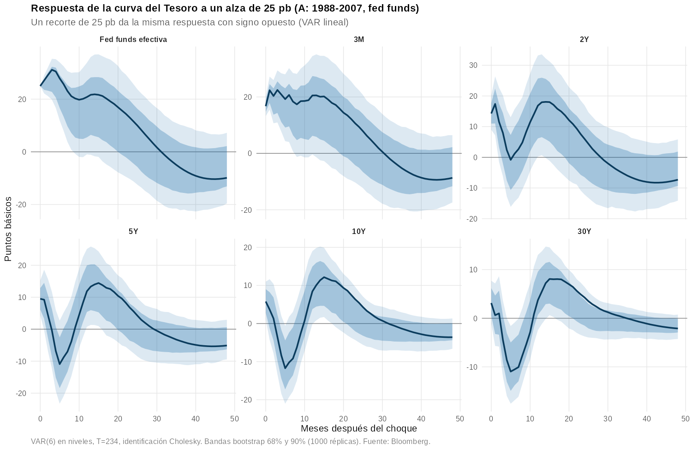
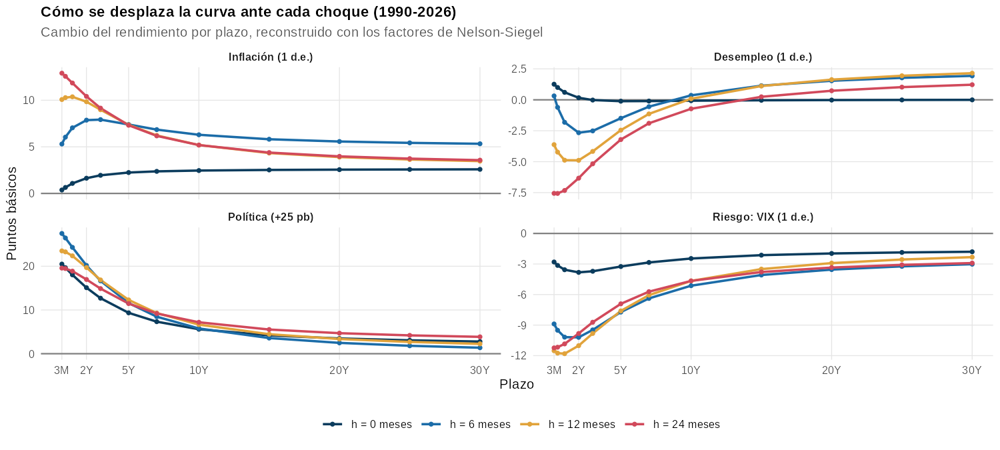
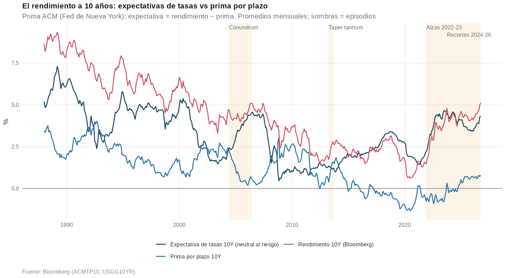
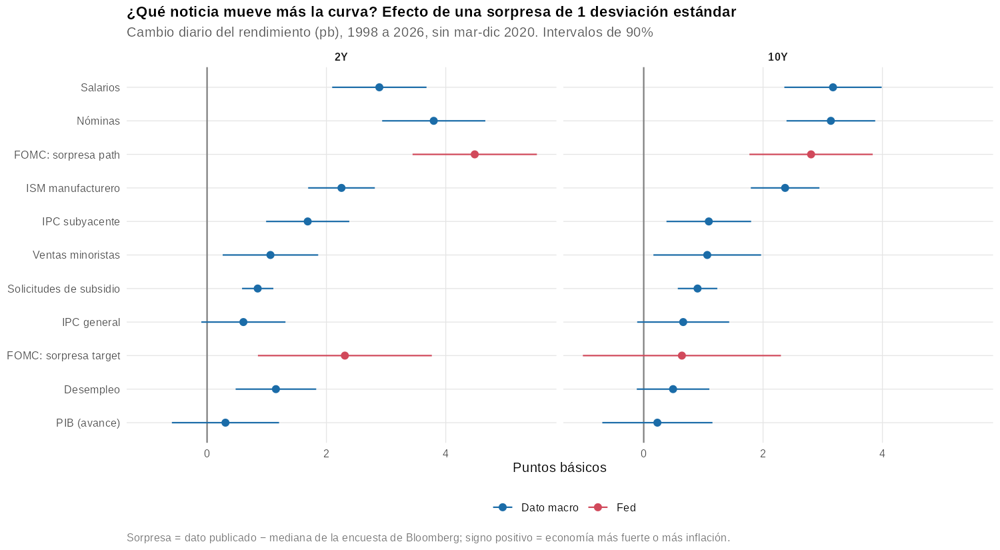

# VAR de tasas: choques de la Fed y la curva del Tesoro de EE.UU.

**Pregunta.** ¿Cómo responden las tasas y los precios de los bonos del Tesoro (corto, mediano y largo plazo) ante un alza o un recorte de la tasa de la Fed?

**Datos.** Bloomberg vía R (`Rblpapi`), 1988-01 a 2026-10, mensual. Fed funds efectiva (`FEDL01`), rendimientos genéricos del Tesoro a 3M, 2Y, 5Y, 10Y y 30Y (`USGG*`), producción industrial (`IP`), IPC (`CPI INDX`), commodities (`BCOM`) e índices total return del Tesoro por tramo (`LT01`–`LT11TRUU`).

**Método.** VAR en niveles con identificación recursiva (Cholesky): la macro no reacciona dentro del mes al choque de política; las tasas de mercado sí. Bandas bootstrap de 68% y 90%. Asimetría alza/recorte con proyecciones locales (Jordà 2005). Robustez con BVAR Minnesota (Banbura, Giannone y Reichlin 2010), rezagos, ordenamiento y muestra.

## Resultados clave



1. **La transmisión de la fed funds cae con el plazo.** Un alza de 25 pb (1988-2007) sube el 3M en 17 pb, el 2Y en 14, el 5Y en 9.5, el 10Y en 6 y el 30Y en 3 al impacto. **La curva se aplana:** 10Y−3M cae 11 pb.
2. **En precios el efecto crece con el plazo:** −0.27% en el bono a 2 años, −0.46% en el de 10 y −0.48% en el de 30, porque la duración compensa el menor movimiento del rendimiento.
3. **Lo que mueve los bonos largos es la trayectoria esperada, no la tasa de hoy.** Un choque de 25 pb al 2Y (muestra completa) sube el 10Y en 19.5 pb y el 30Y en 14 pb, con caídas de precio de 1.6% y 2.1%. Es entre 3 y 4.5 veces la transmisión de un choque a la fed funds.
4. **Las sorpresas de la fed funds explican poco de la curva:** 3-16% de la varianza de las tasas a 12 meses.
5. **Simetría:** en los primeros ~20 meses alza y recorte son espejo. Antes de 2008 no hay evidencia de asimetría. En la muestra completa los recortes tienden a revertirse después de 2 años. Eso parece reflejar el ciclo (recesión y luego recuperación) más que una transmisión asimétrica.
6. **Robusto:** los efectos al impacto. **No robusto:** la dinámica de mediano plazo (una oscilación del tramo largo entre los meses 5 y 15 desaparece en el BVAR y con 3 rezagos).
7. **Validación de precios:** los índices total return de Bloomberg dan caídas de −1.40% (7-10 años) y −2.24% (20+ años), en línea con el cálculo por duración (−1.55% y −2.13%).

Detalle de decisiones, tests fallidos y lectura económica: **[docs/hallazgos.md](docs/hallazgos.md)**.

## Ejercicio con la EFFR y sorpresas de mercado


Con los futuros de fed funds (FF1-FF4) se mide la parte **inesperada** de cada una de las 269 decisiones del FOMC entre 1994 y 2026. Esa sorpresa se usa como instrumento para un VAR con la **EFFR** como tasa de política.

1. **Lo esperado ya está en precios.** Solo la parte inesperada de un cambio de meta mueve la curva (Kuttner): 25 pb inesperados suben el 3M 17 pb y el 2Y 10 pb.
2. **La tasa de hoy mueve el tramo corto; la trayectoria mueve el largo.** Una sorpresa sobre la tasa actual no mueve el 10Y ni el 30Y. Una sorpresa sobre la trayectoria (FF4) de 25 pb sube el 2Y 32-42 pb y el 10Y 24-27 pb.
3. **VAR con EFFR y toda la muestra (1988-2026):** el instrumento es fuerte (F = 16). Un alza de 25 pb sube el 3M 22 pb y el 2Y 15 pb, deja el 10Y sin cambio y baja el 30Y 2 pb: aplanamiento fuerte. Cholesky sobreestimaba la transmisión al tramo largo.
4. **Asimetría en el día del anuncio (1994-2007):** las sorpresas restrictivas suben el 2Y y el 5Y; las expansivas casi no los mueven (p < 0,01).

Scripts: `R/08_descarga_futuros.R` (Bloomberg), `R/09_sorpresas_eventos.R`, `R/10_proxy_svar.R`. Detalle en [docs/hallazgos.md](docs/hallazgos.md), sección 7.

## ¿Qué mueve la curva? Factores y macro



La curva se resume en **nivel, pendiente y curvatura** (Nelson-Siegel), que entran a un VAR con desempleo, inflación, la EFFR y el VIX (Diebold, Rudebusch y Aruoba 2006).

1. **La Fed mueve la pendiente, no el nivel:** un alza de 25 pb sube el 3M 23 pb y el 30Y apenas 2 pb.
2. **Inflación:** antes de 2008 casi no movía la curva. En la muestra completa un choque de inflación sube el tramo corto 10 pb, porque el mercado anticipa la reacción de la Fed. La inversión de 2022-2023 se explica sobre todo por choques de inflación (212 de 289 pb).
3. **VIX:** más riesgo baja el tramo corto (−11 pb) y empina la curva. Explica hasta el 17% de la varianza de la pendiente.
4. **El nivel (más del 90%) no lo explica la macro de corto plazo:** refleja expectativas de largo plazo y la prima por plazo.

Script: `R/12_factores_curva.R` (descargas en `R/11_descarga_curva_macro.R` y `R/13_descarga_vix.R`). Detalle en [docs/hallazgos.md](docs/hallazgos.md), sección 8.

## ¿Expectativas o prima por plazo?



El 10Y se separa en expectativa de tasas y prima por plazo (Adrian, Crump y Moench 2013; prima de la Fed de NY vía Bloomberg).

1. **Una Fed más restrictiva sube las expectativas pero baja la prima** (unos −5 pb por cada 25 pb de sorpresa, el día del anuncio y en el VAR con instrumento). Por eso el tramo largo casi no sube ante un alza.
2. **El "conundrum" de 2004-06 fue la prima:** la Fed subió 4 puntos, las expectativas subieron 2,1 y la prima cayó 1,7; el 10Y casi no se movió. **El taper tantrum de 2013** fue casi todo prima (+119 pb).
3. **Desde 2023-10** la Fed recortó 145 pb y el 10Y subió 33 pb, porque la prima subió 47 pb, en buena parte por inflación persistente.
4. **La volatilidad de bonos (MOVE) es el principal motor macro-financiero de la prima:** explica 14-24% de su varianza.

Script: `R/15_prima_plazo.R` (descarga en `R/14_descarga_acm.R`). Detalle en [docs/hallazgos.md](docs/hallazgos.md), sección 9.

## Noticias macro vs. la Fed



El cambio diario de la curva se mide contra las sorpresas de 9 datos macro (publicado − mediana de la encuesta de Bloomberg) y de la Fed, de 1998 a 2026 (Gürkaynak, Sack y Swanson 2005).

1. **En el 2Y manda la Fed** (sorpresa de trayectoria: 4,5 pb por 1 d.e.). **En el 10Y pesan igual el empleo y la actividad** (nóminas 3,1, salarios 3,2, ISM 2,4) y la Fed (2,8).
2. **Una economía fuerte sube la prima por plazo; una Fed dura la baja.**
3. **El IPC pasó a ser el dato clave en 2021-2026:** sube el 2Y unos 4-5 pb por 1 d.e. (antes, ~0) y los días de IPC pasaron a ser los más volátiles. El empleo perdió peso relativo.
4. **Las expectativas de inflación de largo plazo siguieron ancladas:** el swap de inflación 5y5y no reaccionó al IPC en 2021-2026, y una Fed restrictiva lo bajó.

Script: `R/17_noticias_macro.R` (descarga en `R/16_descarga_noticias.R`). Detalle en [docs/hallazgos.md](docs/hallazgos.md), sección 10.

## Cómo correr

**Actualizar los datos (PC de la oficina, con la Terminal Bloomberg abierta)**

1. En RStudio, abrir `R/actualizar_datos.R` y presionar **Source**. Corre las 6 descargas (unos 5 minutos) y al final muestra un resumen OK/FALLÓ.
2. Doble clic en **`subir_datos.bat`**. Sube solo `data/raw/` y descarta los resultados que la PC haya regenerado; si algo falla, muestra el error.

**Regenerar los resultados (cualquier PC con R)**

- `R/00_paquetes.R` una vez; luego `R/run_all.R` (unos 3 minutos).
- Regla del proyecto: **desde la oficina se suben solo datos; los resultados (`output/`) se regeneran y versionan de un solo lado**. Así el repositorio no se llena de cambios falsos por fuentes o redondeos distintos entre Windows y Linux. Si se corrió `run_all.R` en la oficina, `subir_datos.bat` (o `git restore .`) deja la copia igual a GitHub.

Paquetes: `ggplot2`, `patchwork`, `urca`, `tseries`, `sandwich`, `lmtest`, `zoo`. El VAR, el bootstrap, la FEVD, el BVAR y el proxy SVAR están programados en `R/var_funciones.R`, sin paquetes de VAR, para que cada paso quede a la vista.

## Estructura

```
subir_datos.bat            sube data/raw a GitHub con un doble clic (Windows)
R/actualizar_datos.R       corre todas las descargas de Bloomberg (01, 08, 11, 13, 14, 16)
R/01_descarga_bloomberg.R  descarga y validación de tickers (Rblpapi)
R/02_base_mensual.R        promedios mensuales, logs, interpolación de oct-2025
R/03_inspeccion.R          paneles por serie, raíz unitaria, curva, colinealidad
R/04_var_base.R            VAR A (1988-2007, fed funds) y B (muestra completa, 2Y): IRF, FEVD, diagnósticos
R/05_asimetria_lp.R        proyecciones locales con choques positivos y negativos
R/06_precios_bonos.R       de rendimientos a precios (revaluación y duración); validación con índices TR
R/07_robustez.R            BVAR, rezagos, orden, muestra, sin 3M
R/08_descarga_futuros.R    descarga FF1-FF6 (Rblpapi)
R/09_sorpresas_eventos.R   sorpresas target/path, estudio de eventos FOMC, Kuttner, asimetría
R/10_proxy_svar.R          VAR con instrumento externo (EFFR y 6M)
R/11_descarga_curva_macro.R  plazos 3Y/7Y/20Y y macro (Rblpapi)
R/12_factores_curva.R      factores Nelson-Siegel + VAR macro-curva, FEVD, descomposición histórica
R/13_descarga_vix.R        VIX y MOVE (Rblpapi)
R/14_descarga_acm.R        prima por plazo ACM 2/5/10 años (Rblpapi)
R/15_prima_plazo.R         expectativas vs prima: episodios, eventos FOMC, VAR, descomposición histórica
R/16_descarga_noticias.R   datos macro con fecha, publicado y mediana de encuesta; breakevens (Rblpapi)
R/17_noticias_macro.R      sorpresas macro vs FOMC: efecto por noticia y plazo, cambios por período, volatilidad por día
R/var_funciones.R          funciones propias (VAR, Cholesky, bootstrap, FEVD, BVAR, LP)
R/utils.R                  rutas y estilo gráfico (fondo blanco, Arial)
output/figuras, output/tablas, docs/hallazgos.md
```

## Figuras

| Archivo | Contenido |
|---|---|
| `curva_fed_tesoro.png` | Fed funds y curva, con el ZLB sombreado |
| `inspeccion_*.png` | Inspección serie por serie |
| `irf_curva_A.png`, `irf_curva_B.png` | Respuesta de la curva a +25 pb |
| `irf_pendiente_*.png` | Respuesta de las pendientes 10Y−3M y 30Y−2Y |
| `irf_macro_*.png` | Respuesta de IP, IPC y BCOM |
| `irf_alza_vs_recorte_A.png` | Alza vs recorte en el VAR lineal (espejo) |
| `lp_asimetria_*.png` | Alza vs recorte en proyecciones locales |
| `precios_bonos_*.png` | Respuesta de precios por tramo |
| `robustez_irf.png` | Comparación de especificaciones |
| `sorpresas_serie.png` | Sorpresas target y path en cada anuncio |
| `eventos_*.png` | Estudio de eventos: efecto por tramo, dispersión, persistencia diaria |
| `proxy_irf_P*.png`, `proxy_vs_cholesky.png` | VAR con instrumento externo y comparación con Cholesky |
| `ns_factores.png` | Nivel, pendiente y curvatura vs medidas empíricas |
| `mc_irf_factores_*.png`, `mc_desplazamiento_curva_*.png` | Respuesta de los factores y de toda la curva a inflación, desempleo, Fed y VIX |
| `mc_fevd.png`, `mc_descomposicion_historica.png` | Qué explica cada factor; qué movió la curva desde 2015 |
| `acm_*.png` | Expectativas vs prima por plazo: historia, días FOMC, VAR, descomposición histórica |
| `noticias_*.png` | Sorpresas macro vs Fed: efecto por noticia, por plazo, por período y volatilidad por día |
